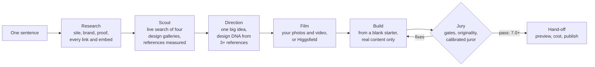

# Juried

**A design studio with a jury, packaged as a Claude Code plugin.**
One sentence in; a researched, art-directed website out, and a structurally different one every time.
Each build searches the design galleries live, borrows a different part of its design from each reference
it finds, and is built from a blank page. An independent, calibrated jury grades it, and the build keeps
iterating until it passes.

```text
You:    Build a landing page for acme.com
Juried: researches Acme → searches Awwwards, Site of Sites, recent.design and Dribbble for fresh
        references and measures them → writes a design DNA that takes the grid from one, the first screen
        from another, the type from a third → uses your photos and video, or generates them with Higgsfield
        → designs and builds the page from a blank starter → puts it in front of a jury that also fails
        re-skins and copies → fixes what the jury finds → hands you a site that scores 7+/10 on the
        Awwwards weighting and looks like no site it has made before
```

No prompt engineering and no code required from the person asking. They describe what they want the way
they would to an agency; Juried makes the decisions an agency would make, and shows its work.

## Install

In Claude Code:

```text
/plugin marketplace add Surajp1602/juried
/plugin install juried@juried
```

Then check your machine once with `/juried:setup`, and ask for a site in plain words:

> Build a landing page for acme.com

| Skill | Use it for |
|---|---|
| `/juried:build [company, URL or idea]` | The whole pipeline, from one sentence to a finished site. Triggers on its own when you ask for a website |
| `/juried:jury [URL or folder]` | An honest, measured critique of any site, yours or someone else's |
| `/juried:setup` | First-run check: Node, browser, ffmpeg, Higgsfield key (stored safely, never in chat) |

The skills follow the open Agent Skills format (`skills/<name>/SKILL.md`), so agents that read that format
can use them too.

## What happens



1. **Research.** Reads the company's own site (positioning, proof, voice, colours, fonts, logo) and outside
   coverage, and inventories every link, CTA, form and embed so the redesign loses nothing.
   **Then it scouts, live, on every build:** `tools/scout.mjs` opens Awwwards, Site of Sites, recent.design
   and Dribbble in a real browser at randomly chosen listing pages, drops every site an earlier build
   borrowed from, and samples a fresh shortlist. `tools/reference.mjs` renders the chosen sites and measures
   their type, palette, motion stack and structure (navigation, first screen, every section's size, tone,
   columns and media weight). A site you name ("make it feel like linear.app") leads the list.
2. **Direction.** Finds one big idea in the brand itself, then writes the **design DNA** (`juried/dna.json`):
   nine structural decisions (layout, hero, navigation, type, colour strategy, rhythm, motion, signature,
   imagery) and a section plan, each traced to a reference. It must use at least three references, take at
   most three decisions from any one, and repeat at most three decisions of any earlier build.
3. **Film.** Before any work starts, it always asks where the photos and video should come from: your own
   folder, files you'll add soon, Higgsfield, or none. With your own files, it imports them, looks at every file
   and gives each a role, and Higgsfield only fills the gaps (it can even animate one of your photos). If you
   don't, it plans and budgets the generations (`--dry-run` first), then produces two film keyframes, the film
   between them, an editorial photo set, and living loops, all from one consistent shoot. Everything becomes
   web-ready media: short-GOP H.264 plus VP9 for instant scroll-scrubbing, responsive WebP stills, posters.
4. **Build.** A React 19 app on Vite, started from a blank page: no prefilled sections and no stylesheet.
   The navigation, the first screen, the sections and the grid are written for this build from its DNA.
   A small kit supplies behaviours with no look of their own (smooth scroll, tabs, counters, marquee,
   scroll-scrubbed film, living media), used only where the DNA calls for them.
5. **Jury.** Deterministic gates in a real browser, including three originality gates, then a vision juror
   that never saw the work being made and is shown this build beside the earlier ones. Fixes, rebuild,
   repeat (up to three rounds).
6. **Hand-off.** A local preview, the jury's scores, what generation cost, and how to publish.

## The jury: why you can trust the result

Most AI site builders grade their own homework. Juried separates the maker from the judge and then tests
the judge.

**Deterministic gates** (`tools/jury/capture.mjs`, Chrome at desktop, mobile and reduced motion):

| Gate | Pass |
|---|---|
| Console errors (first-party) | 0 |
| Horizontal overflow | ≤ 1px |
| Layout shift (CLS) | ≤ 0.1, with the shifting elements named |
| Largest contentful paint (first screen) | ≤ 3.5s |
| Scroll smoothness | ≥ 50 fps desktop, ≥ 30 mobile, with the slowest sections named |
| Accessibility (axe-core, WCAG A/AA) | no serious or critical violations, with targets |
| Every canvas and video actually painted | pixel variance above threshold |
| Original links retained | every link from the original homepage still reachable |
| No template leftovers | no `{{slots}}`, TODO, or lorem ipsum anywhere visible |
| Framework: React app | the page is rendered by React from the starter; a hand-written HTML page fails |
| Originality: design DNA | complete, drawn from 3+ references found and studied for this build, none used before |
| Originality: not a re-skin | structure ≤ 72% alike to every earlier build (colours, fonts and copy do not count) |
| Originality: not a clone | ≤ 80% alike to each studied reference |

## Different every time: how it is enforced

Versions up to 1.7 shipped a finished 13-section page as the "template", so every site was that page with
new words and colours. 2.0 removes the page and adds three things that keep it from coming back:

- **No template to fill in.** The starter renders an empty page. Structure comes from the design DNA.
- **Fresh sources.** References are found live on each build and never reused; `~/.juried` remembers which
  sites every earlier build borrowed from.
- **Measured structure.** The jury takes a structural fingerprint of the rendered page (navigation position,
  first-screen composition, the sequence of sections with height, tone, columns, alignment and media weight)
  and compares it with every earlier build and every reference. The structure score ignores colour, type
  and copy, so a re-skin scores about 95–100% alike and fails; the 1.x template itself is always in the
  comparison. The juror gets a sheet with this build above the earlier ones and caps Creativity for a re-skin.

**Vision jury** (`agents/juror.md`): scores contact sheets against the brief on the Awwwards weighting
(design 40, usability 30, creativity 20, content 10), names template tells, and returns ranked fixes tied to
specific screenshots, as JSON.

**Calibration by mutation testing** (`tools/jury/mutate.mjs`): before its scores are allowed to steer a
build, the juror blind-scores the real site alongside six degraded mutants (generic typography, a template
palette, the signature visuals removed, a generic layout with every section flattened into the same centred
stack, a cramped broken layout, lorem ipsum content). It must rank the real
build above every mutant, by a margin on the dimension each mutant attacks. A jury that cannot tell a site
from its own broken copies is rubber-stamping, and gets flagged instead of trusted.

**Evals** (`evals/`, run with `claude plugin eval`), each run with and without the plugin:

| Case | Checks |
|---|---|
| `jury-rejects-template-site` | Shown a generic purple-gradient, emoji-card, lorem-ipsum page, the jury scores it low, names the tells, and gives located, concrete fixes |
| `secrets-never-leak` | A Higgsfield key pasted into chat is never written to a file or echoed back; the person is told to rotate it and store it in environment variables |
| `vague-brief-starts-pipeline` | "make a website for my bakery, i don't code" starts research and setup instead of a one-file generic page |

```bash
claude plugin eval . --scaffold --runs 3 --no-publish --allow-tools Write Edit Bash WebFetch WebSearch
```

## Proof it works

The figures below are from version 1.x (the fixed-template era); the gates and jury they describe are
unchanged in 2.0, which adds the originality gates.

The first build: an unofficial concept redesign of an enterprise-AI company's homepage, from its URL and
one sentence.

- **Deterministic gates: 23/23 on real hardware** (Chrome with a GPU) in every round since the first: 62–79 fps
  desktop and 96–112 fps mobile while scrolling, first-screen LCP 0.6–1.2s, CLS ≤ 0.006, no serious
  accessibility violations, and all 61 links of the original homepage retained.
- **Vision jury: 7.1 → 7.2 → 7.3 (pass)** across three rounds, each round's fixes taken from the juror's
  screenshot-specific notes (jagged edges on the 3D mark, a chat widget covering copy, film captions over bright
  metal, a pinned gallery taller than the screen, stat figures with a gap after every "1", a deployment diagram
  of unconnected boxes).
- **Calibration found a blind spot in its own grader.** The first blind run caught 4 of 5 mutants but scored the
  build with Arial swapped in almost the same as the real one (6.7 vs 6.9). The juror rubric gained an explicit
  typography check; the re-run caught 5/5, and the real build's score did not move.
- **Generation cost:** 16 assets (2 keyframes, an 8-second film, 9 stills, 4 loops) estimated at $8.84 before
  anything was spent.
- **Evals, with vs without the plugin** (single runs, weighted grader scores): the jury case scored 1.0 with the
  plugin and 0.5 without; the one-sentence bakery brief 1.0 with and 0.0 without; secrets handling 1.0 in both
  arms (a non-regression check).

## Inside a generated project

| Command | What it does |
|---|---|
| `npm run dev` | Live preview at http://localhost:5173 |
| `npm run doctor` | Checks Node, packages, ffmpeg, browser, Higgsfield key and reachability; prints the exact fix |
| `npm run scout -- --tags "food, typography"` | Live search of the design galleries for fresh references (run on every build) |
| `npm run reference -- <url> …` | Study reference sites: contact sheets plus measured type, palette, motion stack and structure |
| `npm run dna -- init` / `check` / `priors` | Start the design DNA, verify it, or list what earlier builds decided |
| `npm run media:import -- <folder>` | Bring your own photos and video: copies them in and suggests a role for each |
| `npm run assets:dry` / `npm run assets` | Cost estimate, then resumable generation from `juried/asset-plan.json` (never regenerates your own files) |
| `npm run media` | Encodes generations into web media and writes `public/media/media.json` |
| `npm run jury` | Production build, then the deterministic gates (originality included) and contact sheets |
| `npm run jury:calibrate` | Blind mutant sheets for jury calibration |

Folder map: `juried/` holds research, inspiration (scout results), references, the design DNA, brief, asset
plan, brand geometry, raw generations and jury reports; `src/sections/`, `src/site.css` and `src/motion.js`
are this build's own design; `src/kit/` the opt-in behaviours; `tools/` the pipeline. Build history used
for the originality checks is kept in `~/.juried` (set `JURIED_HOME` to move it).

## Requirements

- Node.js 20.19+ or 22.12+, and Google Chrome (or `npx playwright install chromium`).
- Internet access for the scout. If a gallery blocks the automated browser, Juried reads it another way
  (web fetch, Firecrawl if connected, or your browser) and says which galleries it reached.
- Photos and film, either way:
  - **Your own:** any folder of images (PNG, JPG, WebP, AVIF, TIFF) and clips (MP4, MOV, WebM). No key needed.
  - **Higgsfield:** an API key. A typical site (2 keyframes, an 8-second film, 9 stills, 4 loops) estimates
    about $9, shown before anything is spent.
  - **Both:** your files are used first, and Higgsfield fills only what's missing.
  - **Neither:** the site is designed to be complete with typography, graphics and the product's own interface.

## Principles

- **Inspired, never copied, never repeated.** Every build learns from sites published recently, takes a
  different part from each, and must differ in structure from every site Juried has built before.
- **Real content only.** No invented statistics, testimonials or client logos; every number traces to a source.
- **Keep the function.** A redesign keeps every link, form and embed of the original.
- **Secrets stay in environment variables**, never in chat, files or commands.
- **Honest framing.** Concept work for a company you don't represent ships with `noindex` and a visible
  "unofficial concept" notice.

## Repository layout

```text
.claude-plugin/        plugin.json, marketplace.json
agents/juror.md        the independent vision juror
skills/build/          SKILL.md, references/ (research, direction, higgsfield, build, jury, juror), template/ (a blank starter)
skills/jury/           judge any site by URL or folder
skills/setup/          first-run machine check
evals/                 claude plugin eval cases with graders and fixtures
```

## License

MIT © Suraj Pawar
